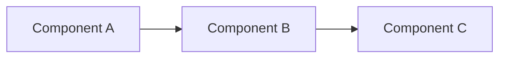
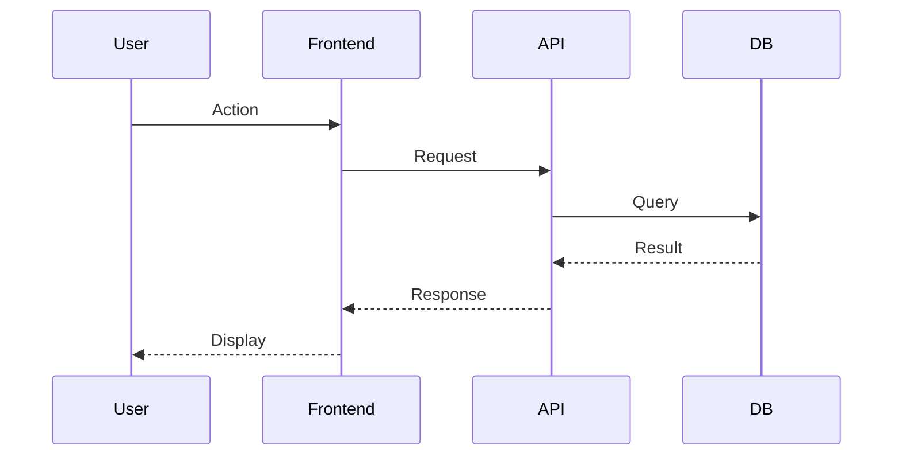
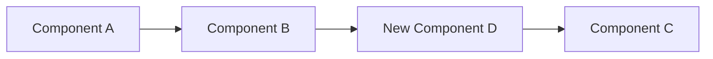
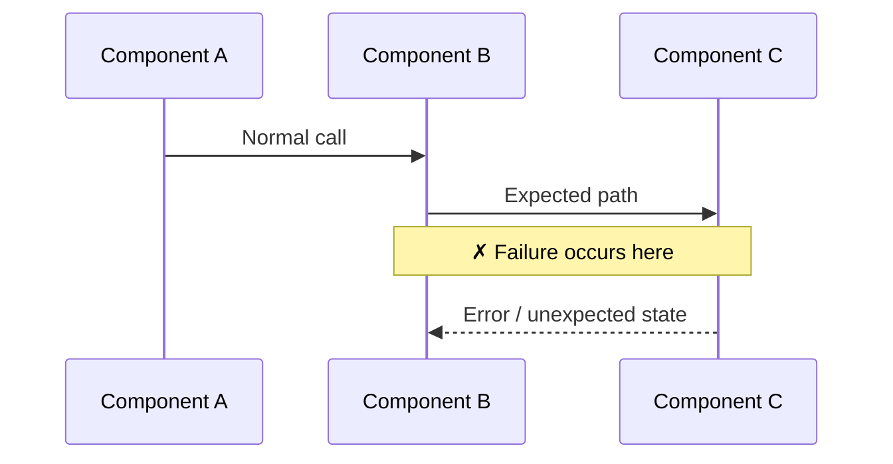

# Work Tracking Document Templates

The four work-tracking documents (`analysis.md`, `plan.md`, `progress.md`,
`review.md`) follow strict templates. Use the language matching the
user's prompt — Chinese if the prompt contains any Chinese characters,
otherwise English. The Markdown structure is identical between the two
languages; only the labels differ.

<!-- Canonical source. The lang:en and lang:zh marker blocks are split out by
scripts/sync-shared-assets.py into the bundled `document-templates.en.md`
and `document-templates.zh.md`; each skill reads only the one matching the
document language. -->

## Table of contents

- [Writing rules for decision readers](#面向决策者的写作规则writing-rules-for-decision-readers) — style contract for all four documents
- [`plan.md`](#planmd) — requirements, Success Criteria, Code Map, execution checklist
- [`progress.md`](#progressmd) — dated change log
- [`analysis.md` (feat / refactor)](#analysismd--feature--refactor) — by Planner
- [`analysis.md` (fix)](#analysismd--fix) — by Debugger
- [`review.md` header](#reviewmd-header) — with Evidence table
- [Plan review round](#plan-review-round) — written before implementation
- [Visualization rules for analysis.md](#visualization-rules-for-analysismd)

---

## 面向决策者的写作规则（Writing Rules for Decision Readers）

These rules apply to **all four documents, in both languages, and to
every message that asks the user to decide** — interrogation questions,
confirmations, review verdicts, and the Step 5 report. They are
the "reads like it was written for a person" layer on top of the
machine-checked structure. They bound *how* things are written, never
*what* may be recorded: no rule below is permission to drop evidence,
caveats, or audit detail.

1. **Verdict first, evidence after（先结论，后证据）** — the first
   sentence of every section, finding, and risk answers "what is this /
   what is the conclusion"; evidence and detail follow. 每个章节、每条
   发现、每条风险的第一句直接回答"这是什么/结论是什么"，证据与细节放
   后面。Good: "**iOS 冷启动必现崩溃** —— 崩溃点在主题切换后的资源释
   放路径，堆栈见下。" Bad: "经过对多个子系统的分析并交叉比对日志后，
   发现可能存在一个潜在问题……"
2. **Explain every term on first use; give an example where it is
   subtle（术语首用必解释，微妙处必举例）** — an abbreviation or piece
   of jargon gets one line of plain words the first time it appears; a
   mechanism gets one concrete scenario or analogy. 缩写与行话首次出现
   给一行大白话；机制给一个具体场景或比喻。Good: "UAF（use-after-free，
   释放后使用）——对象已释放但代码还在用，如同房间退租后还有人拿旧钥匙
   进来，表现为随机崩溃重启。" Bad: "命中 UAF，需排查。"（首次出现无解释）
3. **Never use a coined term bare（自造缩略语禁裸用）** — a name this
   work item invented（三同步约束、假绿、判定性实验……）is spelled out in
   plain words on first use; the short form may appear afterwards. 项目
   自造的名字首次出现必须拆开说清，之后才可用简称。Good: "三同步约束
   （plan_lint.py、references 模板、SKILL.md 三处必须同步改动）。"
4. **One claim per sentence（一条一个论点）** — more than two levels of
   subordination or parentheses means split the sentence; paths, version
   numbers, and line numbers belong in the evidence layer, not in the
   claim sentence. 超过两层转折或括号就拆句；路径、版本号、行号放证据
   层，不进论点句。Bad: "根因是 A（因为 B，而 B 又依赖 C（见 D:120，
   v2.3.1）），同时 E 的历史包袱导致 F，但 G 在另外的分支上已经……"
   ——一层句子塞四个论点加三层括号。Good: 论点句只说一件事，路径、版
   本、行号挪到证据行："根因是 A（见证据 1）。证据 1：`D:120`，v2.3.1
   起引入；证据 2：……"
5. **Ids are an index, not the content（编号是索引不是内容）** — the
   first occurrence of an id in a document carries a 3–8 character
   gloss; the sentence must still read cleanly with the ids covered. 每
   份文档里编号首次出现带 3–8 字说明；遮住编号句子仍要读得通。Bad:
   "T3 同步 + SC3/SC6 双断言 + 三同步约束。" Good: "T3（同步三处 lint
   副本）落地后，SC3 与 SC6 的断言（副本逐字节一致）随之生效。"
6. **Process noise is not content（过程与技术分离）** — AI workflow
   detail（子代理、门禁、簿记）goes into progress's process-notes tail or
   the review round that produced it, never mixed into technical
   conclusions. AI 工作流细节进 progress 的过程记录或产生它的审查轮次，
   不与技术结论混排。Bad: progress 技术条目里写"子代理运行至 150 轮上限
   被中断"。Good: 该细节放进 `（过程记录：…）`。
7. **Field lines are separate paragraphs（字段行各自成段）** — two
   consecutive lines that each start with a bold label (`**Source**:`,
   `**来源**：`) MUST be separated by a blank line, in every template and
   every generated document. Markdown renders consecutive lines of one
   paragraph as a single merged line: the source looks line-broken in an
   editor, but any preview fuses the whole header into one line.
   相邻两行 `**字段**：…` 之间必须空一行：Markdown 渲染会把同一段落的
   连续行合并成一行，编辑器里看着分行、预览里就粘成一长行。
8. **One language per document; borrow a foreign term only when it is the
   industry name（全文一种语言，外文只在必要时用）** — after the document
   language is decided, keep the whole document in it. An English term
   stays English only when it IS the industry name (`API`, `JWT`,
   `webhook`, `OAuth`) or has no accepted translation; when a widely used
   term exists in the document language, use it and put the original in
   parentheses on first use. Do not switch languages mid-sentence when a
   plain word in the document language says the same thing. 全文使用选定
   的那一种语言：术语本身就是行业名（API、JWT、webhook）或没有通行译名
   时保留外文；有通行译名的用中文表述并在首次出现时括注原文；句中不无
   故夹用外文。Good: "这条调用链的消费方会出现延迟回退（latency
   regression）。" Bad: "这个 flow 的 consumer 侧会有 latency regression。"
9. **Write like you explain to a colleague, not like a translated manual
   （像给同事讲，不像翻译腔）** — plain verbs and normal word order beat
   formal register and noun piles. 术语解释完了就直接说事，用平实的动词
   和正常语序，避免堆名词的公文体与翻译腔。Good: "把同步任务从轮询改成
   事件推送，因为轮询每 5 秒查一次库，成本太高。" Bad: "本方案拟对现有
   同步机制实施基于事件驱动范式的替代性迁移，以规避高频轮询所衍生的资
   源开销问题。"
10. **Decisions come with an example and the stakes（决策带例子，带代价）
    ** — every question or approval ask that reaches the user carries a
    concrete `比如` / `for example` line grounded in the feature being
    planned, states what a wrong answer costs to redo and whether that is
    cheap, and marks cheap-to-reverse decisions as safe to default. An
    approval ask quotes the plain-words summary, never a wall of ids. A
    question the user cannot evaluate gets a blind `按推荐`, which teaches
    the process nothing. 每个送到用户面前的追问或确认都带一个落在当前
    功能上的具体例子，说清答错要返工什么、好不好改；好改的明说"拿不准
    就按推荐"。请求确认时引用大白话摘要，而不是一串编号。Good: "旧版
    App 打不开设置页怎么办？比如：设置项换了存法，还装着旧版的手机要照
    样能打开设置。推荐：保留旧格式的读法——旧版只是看不到新设置项，改
    起来也快。" Bad: "Q2 — persisted schema backward-compatibility
    strategy？（无解释、无例子、无代价）"

---

## `plan.md`

### Status is the directory location — no Status field

The lifecycle state of a work item is expressed by its directory
location, NOT a text field. Active work lives in
`<docs-dir>/changes/<type>/<work-name>/`; archived work lives in
`<docs-dir>/changes/archive/YYYY-MM-DD-<type>-<work-name>/`. Do NOT
write a `**Status**:` field in `plan.md`.

### English

```markdown
# <Work Name>

**Source**: <Jira link / user prompt / Confluence page / predecessor work item>

**Type**: feat | refactor | fix

**Branch**: <branch-name>

**Created**: <date>

## Summary

**In one sentence**: <what the problem is and what we'll do — no ids, no file refs>

**In plain words**: <what will be different once this ships — one line a non-engineer can read, no ids; include the biggest remaining risk when there is one>

**Status**: <planning | ready to implement | in progress | done> — <one-line latest verdict>

**Decisions needed from you**: <none; or one line each: question → options → our recommendation>

**Not solved here**: <explicit exclusions, pending verifications, residual risks — one line each>

**Where to read**: problem detail → analysis.md; how → this file's body; evidence → review.md

## Requirements

<Summary of requirements from gathered context>

## Success Criteria

<Testable, specific acceptance criteria — "Works correctly" is not a
criterion; "returns 200 with valid JSON matching schema X for inputs A,
B, C" is. Each criterion is checked against evidence in review.md.>

- [ ] Criterion 1: <observable behavior + expected outcome>
- [ ] Criterion 2: <...>

## Affected Repositories (in dependency order)

| # | Repository | Branch | Changes Needed | Depends On | Priority |
|---|-----------|--------|---------------|-----------|----------|
| 1 | shared-lib | feat/Dark-Mode-Toggle | Add theme types | — | P0 |
| 2 | api | feat/BE-450/Dark-Mode-Toggle | Add preference endpoint | shared-lib | P0 |
| 3 | android | feat/MOBILE-301/Dark-Mode-Toggle | Add toggle screen | shared-lib, api | P1 |

Repos MUST be listed in dependency order: upstream first (shared libs,
data models), then services (api, backend), then consumers (web, ios,
android). fullstack-apply derives its parallel implementation waves
from this table — repos sharing no dependency edge are developed and
committed concurrently. Every interface a downstream repo consumes
MUST be frozen in analysis.md (exact field names, types, error codes):
parallel developers write against the frozen contract, not against
upstream code that may not exist yet.

## Code Map

<The reverse index — which files this work item owns. Written here at
planning time with the paths the plan expects to touch; `fullstack-apply`
replaces planned paths with the paths it actually changed, on every
round. Later readers query this table to find the work item behind a
file, so a path that changed code but is missing here is a change nobody
can trace back to a spec.>

| Repository | Path | Symbols | What changed |
|-----------|------|---------|--------------|
| api | `src/preferences/dark_mode.py` | `ThemePreference`, `GET /pref` | New preference endpoint |
| android | `app/src/ui/SettingsScreen.kt` | `DarkModeToggle` | Toggle row on the settings screen |

Rules:

- **Path is relative to the repo root** (`src/preferences/dark_mode.py`),
  never an absolute machine path and never a bare file name. Prefixing
  the repo column and the repo-relative path is what makes the pair
  greppable from a workspace-relative path. A file that really sits at the
  repo root is written `./README.md` — the `./` says "root", where a bare
  `README.md` leaves the lookup guessing between same-named files in other
  repos.
- **Symbols is optional** — fill it when the file name does not say what
  changed. It is the lookup key for a reader who was told "the
  `computeWave` function is wrong" and has no file path.
- **Rewrite the table in place.** Unlike `progress.md`, this is a current
  state, not a log: a path that was touched then reverted does not stay
  listed. History belongs in `progress.md`. Earlier rounds' files stay in
  the table — it is the item's whole ownership, not this round's diff.
- **One row per file**, no ranges (`src/ui/*`) and no path lists in one
  cell (`src/a.py`, `src/b.py`) — a wildcard or a merged cell cannot be
  matched by a path lookup, so each silently drops traceability for every
  file it pretends to cover. A directory (`src/ui/`) or a placeholder
  (`—`, `待定`) names no file either.

## Implementation Plan

### Phase 1: <name>
- [ ] Task 1 in repo-x
- [ ] Task 2 in repo-y

### Phase 2: <name>
- [ ] Task 3 in repo-x

## Dependencies

<Cross-repo dependencies, order constraints>

## Risks / Open Questions

**Active risks**

| # | Risk | Likelihood | Impact | Mitigation |
|---|------|-----------|--------|------------|
| R1 | <risk, stated as its conclusion> | Medium | High | <mitigation> |

**Closed**

(none — a risk that has closed moves here with one line: why it closed and
where it was resolved. Rows are never deleted; the partition keeps the
live exposure readable at a glance.)
```


### Successor addition

When this work item inherits from an archived predecessor, add a
`Predecessor` line to the header right after `Created`:

- English: `**Predecessor**: feat/dark-mode/ (archived 2026-04-15)`
- Chinese: `**前置工作**：feat/dark-mode/（2026-04-15 归档）`

---

## `progress.md`

`progress.md` is a **dated log**. Every meaningful change — kickoff,
per-repo completion, review-driven fixes, user feedback, follow-up
edits — is recorded as a `### <date>` section. Each entry **opens with a
bold result line** (`**Result**:` / `**结果**：`) — the decision-maker's
first line — and **closes with a process-notes tail**
(`（Process notes: …）` / `（过程记录：…）`) holding AI-workflow detail.
Git history is the authoritative record of code changes; this file is
the human-readable narrative that ties changes to decisions.

### English

```markdown
# Progress: <Work Name>

**Last updated**: <date>

**Branch**: <branch-name>

## Completed Steps

(none yet)

## In Progress

- [ ] <current step>

## Blocked

(none)

## Change Log

### <date> — Started

**Result**: <one or two plain sentences: what happened and where things stand now — the decision-maker's first line>
- Created work plan
- Identified affected repos: <list>
- Created branches in: <list>
（Process notes: <subagent runs, gate output, wording syncs — AI workflow detail>）

### <date> — <what happened>

**Result**: <one or two plain sentences: what happened and where things stand now>
- <what was done, why, and the result>
（Process notes: <AI workflow detail>）
```


### Successor back-link — `## Successors` table (optional)

The forward link is what always carries the chain forward: the
successor's `**Source**` / `**Predecessor**` points at the archived
predecessor and is written for every successor.

A reverse `## Successors` (English) / `## 后续工作` (Chinese) table can
**additionally** be appended to the predecessor's `progress.md` — but
only if the successor is already known while the predecessor is still
active, i.e. **before** it is archived. Because a successor is normally
planned only *after* archiving, this back-link is best-effort and often
absent. That is fine: archive is final and archived directories are
never edited; discovery relies on the `-vN` naming convention plus the
forward link instead.

---

## `analysis.md` — feature / refactor

`analysis.md` is a **technical thinking document** — it captures *why*
decisions were made. Unlike `plan.md` (an execution checklist),
`analysis.md` visualizes system behavior and documents trade-offs.

### English

```markdown
# Analysis: <Work Name>

**Created**: <date>

**Type**: feat | refactor

**Author**: Planner

## Current State

<Describe the existing system behavior, architecture, or user flow.>

### Architecture (as-is)



## Original Requirements

What was asked for, **verbatim** — the user's own words, the Jira
description, the spec text. Not a summary: this is the baseline the
plan-reviewer falsifies coverage against, and a paraphrase here is what
lets a narrowing pass as a documented limitation. One `REQ<n>` id per
ask; `plan.md` and `review.md` cite the ids.

### Clarifications

Question/answer record from the Step 3.5 requirements interrogation — one
row per question asked before planning, `Q1..Qn`, numbered per work item
and never reused. An unanswered row is allowed, but its resolution must
live elsewhere: an `A<n>` row in `plan.md` §Risks / Open Questions, or a
`NEEDS_USER_DECISION` — never a silent assumption. When the gate was
skipped, this subsection may be omitted; the skip reason recorded in
`progress.md` is the record.

| Q | Question | Recommendation | User answer | Plan impact |
|---|----------|----------------|-------------|-------------|
| Q1 | <what only the user can decide> | <the recommended answer> | <the user's answer; `(as recommended)` when they took the default> | <which part of the plan the answer changes> |

An answer that changes what the system must do derives a requirement line
in this section, next to the other `REQ` lines:

- **REQ<n>** "<the user's answer>" — Source: clarification Q<n>

When the user accepted the recommendation, quote the recommendation's own
wording inside the quotes and mark it `(as recommended)` — never write
just "as recommended", which leaves the review baseline with an empty
requirement. An implementation choice that does not change what the
system must do stays in this table; the analysis section that relies on
it cites the Q id.

An unanswered decision that does not block acceptance becomes an `A<n>` row
in `plan.md` §Risks / Open Questions, numbered apart from `R<n>`:
`| A1 | <the assumption, phrased as a fact the plan relies on> | Medium |
High | Reversal: <what would make it false> → <how to back out> |`.

## Requirements Analysis

<Break down requirements into concrete behaviors, inputs, outputs.>

### User Flow



## Design Options

| Option | Approach | Pros | Cons | Complexity |
|--------|----------|------|------|------------|
| A | ... | ... | ... | Low |
| B | ... | ... | ... | Medium |

**Recommended**: Option <X> — <rationale>

## Target Architecture



## Cross-Repo Impact

| Repo | Impact | Breaking Change? |
|------|--------|-----------------|
| shared-lib | New types added | No |
| api | New endpoint | No |
| web | New page | No |

## Risks & Mitigations

| Risk | Likelihood | Impact | Mitigation |
|------|-----------|--------|------------|
| ... | Medium | High | ... |
```


## `analysis.md` — fix

### English

```markdown
# Analysis: <Work Name>

**Created**: <date>

**Type**: fix

**Severity**: <Critical | High | Medium | Low> — <one-line impact>

**Author**: Debugger

## Original Requirements

What was asked for, **verbatim** — the user's own words, the Jira
description, the report as received. Do not summarize or tidy it: this
section is the baseline the plan-reviewer falsifies coverage against,
and a paraphrase here is what lets a narrowing pass as a documented
limitation. One `REQ<n>` id per ask; `plan.md` and `review.md` cite the
ids. `plan_lint.py` fails a round that cites an undeclared id, and one
that never cites a declared id.

- **REQ1** "<exact words>" — <source: user prompt / PROJ-123 / page>
- **REQ2** "<exact words>" — <source>

### Clarifications

Question/answer record from the Step 3.5 requirements interrogation — one
row per question asked before planning, `Q1..Qn`, numbered per work item
and never reused. An unanswered row is allowed, but its resolution must
live elsewhere: an `A<n>` row in `plan.md` §Risks / Open Questions, or a
`NEEDS_USER_DECISION` — never a silent assumption. When the gate was
skipped, this subsection may be omitted; the skip reason recorded in
`progress.md` is the record.

| Q | Question | Recommendation | User answer | Plan impact |
|---|----------|----------------|-------------|-------------|
| Q1 | <what only the user can decide> | <the recommended answer> | <the user's answer; `(as recommended)` when they took the default> | <which part of the plan the answer changes> |

An answer that changes what the system must do derives a requirement line
in this section, next to the other `REQ` lines:

- **REQ<n>** "<the user's answer>" — Source: clarification Q<n>

When the user accepted the recommendation, quote the recommendation's own
wording inside the quotes and mark it `(as recommended)` — never write
just "as recommended", which leaves the review baseline with an empty
requirement. An implementation choice that does not change what the
system must do stays in this table; the analysis section that relies on
it cites the Q id.

An unanswered decision that does not block acceptance becomes an `A<n>` row
in `plan.md` §Risks / Open Questions, numbered apart from `R<n>`:
`| A1 | <the assumption, phrased as a fact the plan relies on> | Medium |
High | Reversal: <what would make it false> → <how to back out> |`.

## Symptom

<Exact observable behavior: error messages, logs, incorrect output.>

## Reproduction

1. <Step-by-step reproduction>
2. ...

**Environment**: <OS, versions, config>

## Root Cause

### System Model



### Cause

<Explain the root cause with evidence. "X is null" is a symptom;
"API changed response format but consumer still expects old format"
is a root cause.>

### Evidence

- Log line: `...`
- Code path: `file:line` → `file:line`
- Timing: ...

## Fix Strategy

| Approach | Description | Risk | Scope |
|----------|-------------|------|-------|
| A | ... | Low | 1 file |
| B | ... | Medium | 3 files |

**Chosen**: Approach <X> — <rationale>

### Before vs After

**Before:**
```
<problematic flow or code>
```

**After:**
```
<fixed flow or code>
```

## Affected Repos

| Repo | Files Changed | Nature of Change |
|------|--------------|-----------------|
| ... | ... | ... |

## Verification

- [ ] Original reproduction steps → no longer fails
- [ ] Regression tests pass
- [ ] Adjacent functionality unaffected

## Follow-ups

- <Preventive measures: tests, monitoring, guards>
```


## `review.md` header

### English

```markdown
# Review: <Work Name>

This file is the work item's falsification record. Canonical order:
status overview (updated in place) → Evidence (seeded here, filled by
code review, closed at finalization) → plan review rounds
(fullstack-propose) → code review rounds and the cross-repo check
(fullstack-apply) → closing verdict.

## Status Overview (updated in place; all rounds and evidence below are append-only)

**Latest verdict**: <plan review PASS_WITH_RISKS (round N) | done — final verdict at the end of this file>

**Review rounds**: <plan review N rounds; code review M rounds (repo names)>

**Active risks**: <N items, one line each: id (plain-language description, how it is being followed up)>

**Open decisions**: <none | list>

## Evidence

Seeded by fullstack-propose with one row per Success Criterion from
plan.md (all `待核验` / `Pending`); each repo's code review fills its
rows, finalization closes the rest. A
criterion without a row here is a criterion nobody verified —
`plan_lint.py` fails the handoff and the finalization gate on it.

| Success Criterion | Result | Evidence |
|-------------------|--------|----------|
| Criterion 1 | ✅ Pass | <test result / PR link / screenshot> |
| Criterion 2 | ❌ Fail | <what disproved it> |
| Criterion 3 | ⚠️ Skipped | <tests not run — no harness or no documented run command> |
```


## Plan review round

Written by **fullstack-propose** (Step 4.5), one section per round, before
any implementation starts. The plan-reviewer subagent returns the content; the
orchestrator appends it. Section labels follow the work item's language.

### English

```markdown
## Plan Review — Round <N> — <date>

### Scope Reviewed

- Documents: analysis.md, plan.md — <what changed since the last round, if N > 1>
- Requirements source: `analysis.md` §Original Requirements + §Clarifications
  (REQ ids + Q ids) — <plus Jira KEY / Confluence page when one exists>
- Codebase verification: <repos inspected> — graphify: used | skipped: <reason> | n/a

### Requirements Coverage

One row per `REQ` id declared in `analysis.md` §Original Requirements —
`plan_lint.py` fails the round when a declared REQ is missing here, and
when a REQ cited here was never declared. Use the ids, not a paraphrase:
`R<n>` belongs to plan.md's risk table, `REQ<n>` to the requirements.

| Requirement | Covered by criterion | Delivered by task | Status |
|-------------|---------------------|-------------------|--------|
| REQ1 | SC-1 | Phase 1, task 2 | OK |
| REQ2 | — | — | **DROPPED** |
| REQ3 | SC-2 | Phase 1, task 3 | **NARROWED** — <what was dropped, and who is asked about it> |

### Findings

- [P0] <doc/section> — <issue> — impact: <what breaks> — fix: <what would resolve it>
- [P1] <doc/section> — <issue> — impact: <rework cost> — fix: <...>

### Verified

- <claims checked and confirmed>

### Unverified

- <what could not be checked, and what would be needed>

### Verdict

<PASS | PASS_WITH_RISKS | NEEDS_FIXES | NEEDS_USER_DECISION> — <summary>

### Open Decisions (NEEDS_USER_DECISION only)

| Decision | Options | Why an AI cannot choose | Blocking |
|----------|---------|------------------------|----------|
| <question> | A / B | <product or policy call> | yes/no |
```

Verdict meanings: `PASS` (implementable as written), `PASS_WITH_RISKS`
(no open P0/P1, risks listed), `NEEDS_FIXES` (P0/P1 the planner can
resolve alone), `NEEDS_USER_DECISION` (blocking item only a human can
choose). `FAIL` and `BLOCKED` are code-review verdicts and do not apply
to a plan.

When the planner rejects a finding, the orchestrator records the
rejection in the same round:

```markdown
- [P0] <issue> — **Rejected**: <the planner's rationale>
```

A finding dropped during revision without a `Rejected:` line is
treated as a new P0 in the next round.


### Author self-check (optional section)

An author's own pre-check of the plan is allowed and often worth
recording — it catches cheap things before the independent audit runs.
It is a **working artifact, not a gate**: its conclusion never
substitutes for a `## Plan Review` round, and the exit criteria ignore
it. Record it above the first plan-review round, clearly labelled:

```markdown
## 设计复核（可选，作者自审，非门禁）— <date>

**结论**：<作者的判断，仅供参考>
```

```markdown
## Design Self-Check (optional, author, NOT a gate) — <date>

**Conclusion**: <the author's own assessment — informational only>
```

### Reconciliation after a revision (MANDATORY)

Planner revisions touch one document at a time and the chain drifts.
After applying revisions, sync in the same edit:

| Revision | Must also update |
|----------|------------------|
| Success Criteria added / renamed / removed | the `## Evidence` table rows in `review.md` |
| A task added / removed / rescoped | the affected-task list in the round's 修订 section |
| Any round or revision | a dated section in `progress.md` |
| A diagram | re-run the Mermaid gate |
| The repositories table | re-run the DAG gate |

Then run the consistency gate:

```bash
python3 SKILL_PATH/scripts/plan_lint.py <docs-dir>/changes/<type>/<work-name>
```

`STATUS=PASS` is required before the plan may be reported ready. It
reports an unclosed review (last round ending in `NEEDS_FIXES`), an
Evidence row missing for a criterion, broken round numbering, and task
ids that no longer exist.

---

## Visualization rules for `analysis.md`

`analysis.md` should favor visual formats over prose wherever possible.
The reader should be able to skim diagrams and tables to grasp the
shape of the change without reading wall-of-text rationale.

| Need to express | Use |
|-----------------|-----|
| System architecture | mermaid `flowchart` or `graph` |
| Request / data flow | mermaid `sequenceDiagram` |
| State transitions | mermaid `stateDiagram-v2` |
| Before / after | markdown tables or side-by-side code blocks |
| Decision matrix | markdown table with trade-off columns |
| Timeline | mermaid `gantt` or numbered list |
| Component relationships | mermaid `classDiagram` or `erDiagram` |

### Mermaid 10.2.3 compatibility

Every diagram MUST parse and render correctly on Mermaid 10.2.3.

**The full rule set lives in [`MERMAID-RULES.md`](MERMAID-RULES.md)** —
shared canonical source kept in sync across all skills. Read that file
end-to-end before authoring any new diagram. The two most common traps:

1. **Unquoted parens / brackets / curlies in edge labels.** Wrap
   the label in double quotes. Same rule for `subgraph` titles.

   - Bad: `A -->|step (x)| B`
   - Good: `A -->|"step (x)"| B`

2. **Literal `\n` inside `flowchart` / `graph` node labels, edge
   labels, or subgraph titles.** On Mermaid 10.2.3 + GitHub + many
   other renderers, `\n` renders as the two characters `\` and `n`
   instead of a line break. Always use `<br/>` for line breaks
   (and wrap in double quotes because the surrounding text usually
   contains `(` or `)`).

   - Bad: `A[xxx-api\n(Domain API)]`
   - Good: `A["xxx-api<br/>(Domain API)"]`

   This rule applies to flowchart-family diagrams only — sequence
   diagrams have separate rendering and are out of scope.

After writing, run the **Mermaid Compatibility Gate**:
`python3 SKILL_PATH/scripts/mermaid_lint.py <file>...` on every
just-written or just-edited file.
The script accepts multiple files in one call. If `STATUS=FAIL`, read
each `ERROR:` line, apply the suggested fix from
[`MERMAID-RULES.md`](MERMAID-RULES.md), save, and re-run until
`STATUS=PASS`. Do NOT proceed to the next step with `STATUS=FAIL`
standing.

The gate runs whenever a mermaid-bearing doc is just written:
1. After writing `analysis.md` for the first time (propose Step 4)
2. After review-driven fixes that updated `analysis.md` (apply)
3. Once on resume, to confirm prior sessions did not leave broken
   diagrams behind

If the script cannot be run, fall back to manual
review against [`MERMAID-RULES.md`](MERMAID-RULES.md). Skipping the
gate entirely is NOT an acceptable shortcut — broken diagrams block
human reviewers.
