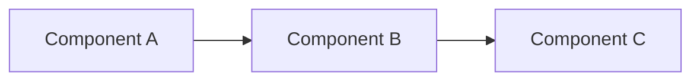
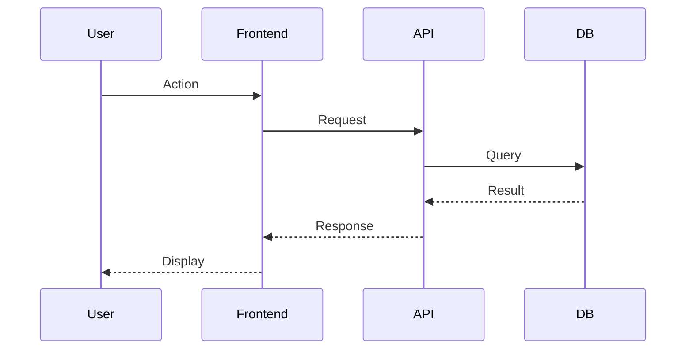
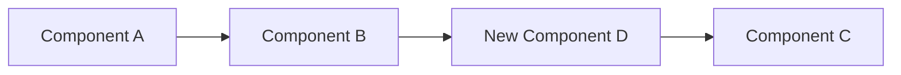
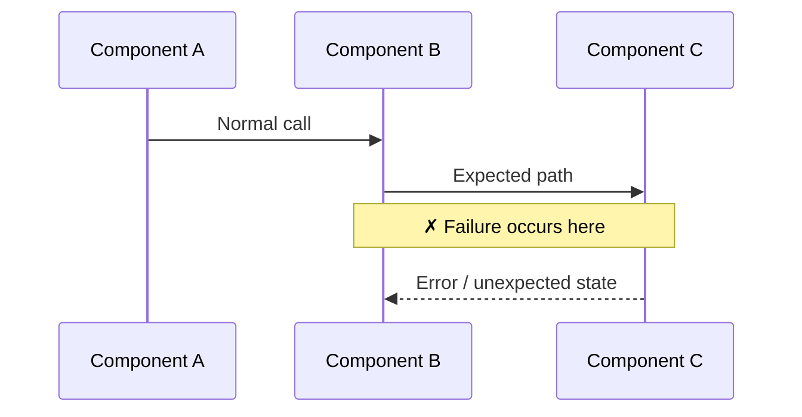

## `analysis.md` — feature / refactor

`analysis.md` is a **technical thinking document** — it captures *why*
decisions were made. Unlike `plan.md` (an execution checklist),
`analysis.md` visualizes system behavior and documents trade-offs.

### English

```markdown
# Analysis: <Work Name>

**Created**: <date>

**Type**: feat | refactor

**Author**: Planner

## Current State

<Describe the existing system behavior, architecture, or user flow.>

### Architecture (as-is)



## Original Requirements

What was asked for, **verbatim** — the user's own words, the Jira
description, the spec text. Not a summary: this is the baseline the
plan-reviewer falsifies coverage against, and a paraphrase here is what
lets a narrowing pass as a documented limitation. One `REQ<n>` id per
ask; `plan.md` and `review.md` cite the ids.

### Clarifications

Question/answer record from the Step 3.5 requirements interrogation — one
row per question asked before planning, `Q1..Qn`, numbered per work item
and never reused. An unanswered row is allowed, but its resolution must
live elsewhere: an `A<n>` row in `plan.md` §Risks / Open Questions, or a
`NEEDS_USER_DECISION` — never a silent assumption. When the gate was
skipped, this subsection may be omitted; the skip reason recorded in
`progress.md` is the record.

| Q | Question | Recommendation | User answer | Plan impact |
|---|----------|----------------|-------------|-------------|
| Q1 | <what only the user can decide> | <the recommended answer> | <the user's answer; `(as recommended)` when they took the default> | <which part of the plan the answer changes> |

An answer that changes what the system must do derives a requirement line
in this section, next to the other `REQ` lines:

- **REQ<n>** "<the user's answer>" — Source: clarification Q<n>

When the user accepted the recommendation, quote the recommendation's own
wording inside the quotes and mark it `(as recommended)` — never write
just "as recommended", which leaves the review baseline with an empty
requirement. An implementation choice that does not change what the
system must do stays in this table; the analysis section that relies on
it cites the Q id.

An unanswered decision that does not block acceptance becomes an `A<n>` row
in `plan.md` §Risks / Open Questions, numbered apart from `R<n>`:
`| A1 | <the assumption, phrased as a fact the plan relies on> | Medium |
High | Reversal: <what would make it false> → <how to back out> |`.

## Requirements Analysis

<Break down requirements into concrete behaviors, inputs, outputs.>

### User Flow



## Design Options

| Option | Approach | Pros | Cons | Complexity |
|--------|----------|------|------|------------|
| A | ... | ... | ... | Low |
| B | ... | ... | ... | Medium |

**Recommended**: Option <X> — <rationale>

## Target Architecture



## Cross-Repo Impact

| Repo | Impact | Breaking Change? |
|------|--------|-----------------|
| shared-lib | New types added | No |
| api | New endpoint | No |
| web | New page | No |

## Risks & Mitigations

| Risk | Likelihood | Impact | Mitigation |
|------|-----------|--------|------------|
| ... | Medium | High | ... |
```


## `analysis.md` — fix

### English

```markdown
# Analysis: <Work Name>

**Created**: <date>

**Type**: fix

**Severity**: <Critical | High | Medium | Low> — <one-line impact>

**Author**: Debugger

## Original Requirements

What was asked for, **verbatim** — the user's own words, the Jira
description, the report as received. Do not summarize or tidy it: this
section is the baseline the plan-reviewer falsifies coverage against,
and a paraphrase here is what lets a narrowing pass as a documented
limitation. One `REQ<n>` id per ask; `plan.md` and `review.md` cite the
ids. `plan_lint.py` fails a round that cites an undeclared id, and one
that never cites a declared id.

- **REQ1** "<exact words>" — <source: user prompt / PROJ-123 / page>
- **REQ2** "<exact words>" — <source>

### Clarifications

Question/answer record from the Step 3.5 requirements interrogation — one
row per question asked before planning, `Q1..Qn`, numbered per work item
and never reused. An unanswered row is allowed, but its resolution must
live elsewhere: an `A<n>` row in `plan.md` §Risks / Open Questions, or a
`NEEDS_USER_DECISION` — never a silent assumption. When the gate was
skipped, this subsection may be omitted; the skip reason recorded in
`progress.md` is the record.

| Q | Question | Recommendation | User answer | Plan impact |
|---|----------|----------------|-------------|-------------|
| Q1 | <what only the user can decide> | <the recommended answer> | <the user's answer; `(as recommended)` when they took the default> | <which part of the plan the answer changes> |

An answer that changes what the system must do derives a requirement line
in this section, next to the other `REQ` lines:

- **REQ<n>** "<the user's answer>" — Source: clarification Q<n>

When the user accepted the recommendation, quote the recommendation's own
wording inside the quotes and mark it `(as recommended)` — never write
just "as recommended", which leaves the review baseline with an empty
requirement. An implementation choice that does not change what the
system must do stays in this table; the analysis section that relies on
it cites the Q id.

An unanswered decision that does not block acceptance becomes an `A<n>` row
in `plan.md` §Risks / Open Questions, numbered apart from `R<n>`:
`| A1 | <the assumption, phrased as a fact the plan relies on> | Medium |
High | Reversal: <what would make it false> → <how to back out> |`.

## Symptom

<Exact observable behavior: error messages, logs, incorrect output.>

## Reproduction

1. <Step-by-step reproduction>
2. ...

**Environment**: <OS, versions, config>

## Root Cause

### System Model



### Cause

<Explain the root cause with evidence. "X is null" is a symptom;
"API changed response format but consumer still expects old format"
is a root cause.>

### Evidence

- Log line: `...`
- Code path: `file:line` → `file:line`
- Timing: ...

## Fix Strategy

| Approach | Description | Risk | Scope |
|----------|-------------|------|-------|
| A | ... | Low | 1 file |
| B | ... | Medium | 3 files |

**Chosen**: Approach <X> — <rationale>

### Before vs After

**Before:**
```
<problematic flow or code>
```

**After:**
```
<fixed flow or code>
```

## Affected Repos

| Repo | Files Changed | Nature of Change |
|------|--------------|-----------------|
| ... | ... | ... |

## Verification

- [ ] Original reproduction steps → no longer fails
- [ ] Regression tests pass
- [ ] Adjacent functionality unaffected

## Follow-ups

- <Preventive measures: tests, monitoring, guards>
```
