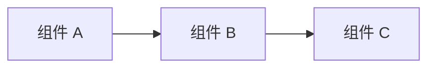
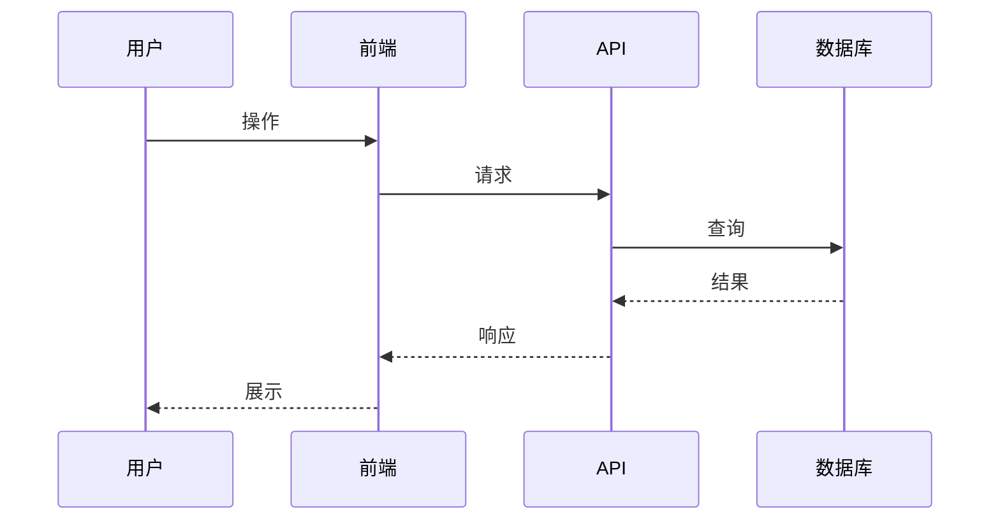
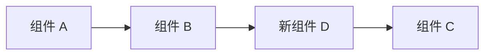
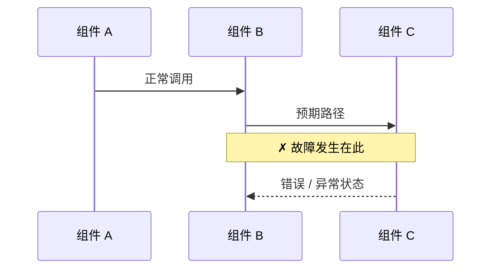

## `analysis.md` — feature / refactor

`analysis.md` is a **technical thinking document** — it captures *why*
decisions were made. Unlike `plan.md` (an execution checklist),
`analysis.md` visualizes system behavior and documents trade-offs.


### Chinese

```markdown
# 分析：<工作名称>

**创建时间**：<date>

**类型**：feat | refactor

**作者**：Planner

## 现状

<描述现有的系统行为、架构或用户流程。>

### 现有架构



## 需求原文

**逐字**记录用户原话 / Jira description 原文 / 规格原文——不转述、不润色。
这一节是方案审查判定"需求有没有被遗漏或收窄"的唯一基线：转述会把收窄藏成
一条"已记录的边界"。每条诉求一个 `REQ<n>` 编号，plan.md 与 review.md 都
引用编号（`R<n>` 留给风险表）。

- **REQ1** 「<原话>」——<来源：用户消息 / PROJ-123 / 页面>
- **REQ2** 「<原话>」——<来源>

### 澄清记录

Step 3.5 追问门的问答记录——规划前问过的每个问题一行，`Q1..Qn` 按工作项编号、
不复用。允许出现未答行，但它的归宿必须在别处：`plan.md` §风险 / 待确认问题 的
`A<n>` 行，或 `NEEDS_USER_DECISION`——不允许静默假设。追问门被跳过时，本节可以
省略；`progress.md` 里记录的跳过原因就是记录。

| Q | 问题 | 推荐答案 | 用户回答 | 对方案的影响 |
|---|------|---------|---------|-------------|
| Q1 | <只有用户能定的决策> | <推荐答案> | <用户回答；接受默认时写"（按推荐）"> | <会改变方案的哪一部分> |

回答改变了"系统必须做什么"时，在本节里（与其他 `REQ` 行并列）派生一条需求：

- **REQ<n>** "<用户回答原文>" — 来源：澄清 Q<n>

用户接受推荐时，引号内引用推荐答案自己的措辞并标 `（按推荐）`——不能只写
"按推荐"，否则审查基线里会是一条空需求。不改变"系统必须做什么"的实现选择
留在本表；引用它的分析章节写明 Q 编号。

未答且不影响验收的决策写成 `plan.md` §风险 / 待确认问题 的 `A<n>` 行，与
`R<n>` 分开编号：`| A1 | <假设，按方案依赖的事实陈述> | 中 | 高 | 反转条件：
<什么情况下失效> → <怎么回退> |`。

## 需求分析

<将需求拆解为具体的行为、输入、输出。>

### 用户流程



## 设计方案

| 方案 | 思路 | 优势 | 劣势 | 复杂度 |
|------|------|------|------|--------|
| A | ... | ... | ... | 低 |
| B | ... | ... | ... | 中 |

**推荐**：方案 <X> — <理由>

## 目标架构



## 跨仓库影响

| 仓库 | 影响 | 是否破坏性变更？ |
|------|------|-----------------|
| shared-lib | 新增类型定义 | 否 |
| api | 新增接口 | 否 |
| web | 新增页面 | 否 |

<!-- 这里不放风险表：风险（R<n>）与假设（A<n>）只写在 plan.md §风险 / 待确认问题
一处。两份副本必然漂移，而且每个代理都要读两遍。analysis 各节引用 R<n> / A<n>
编号即可。 -->
```

---


## `analysis.md` — fix


### Chinese

```markdown
# 分析：<工作名称>

**创建时间**：<date>

**类型**：fix

**严重程度**：<严重 | 高 | 中 | 低> — <一句话影响>

**作者**：Debugger

## 需求原文

**逐字**记录用户原话（或 Jira description 原文、收到的报告原文）——不转述、
不润色。这一节是方案审查判定"需求有没有被遗漏或收窄"的唯一基线：转述会把
收窄藏成一条"已记录的边界"。每条诉求一个 `REQ<n>` 编号，plan.md 与
review.md 都引用编号（`R<n>` 留给风险表）。引用了未声明的编号、或声明了
却没有任何轮次引用，`plan_lint.py` 都会报错。

- **REQ1** 「<原话>」——<来源：用户消息 / PROJ-123 / 页面>
- **REQ2** 「<原话>」——<来源>

### 澄清记录

Step 3.5 追问门的问答记录——规划前问过的每个问题一行，`Q1..Qn` 按工作项编号、
不复用。允许出现未答行，但它的归宿必须在别处：`plan.md` §风险 / 待确认问题 的
`A<n>` 行，或 `NEEDS_USER_DECISION`——不允许静默假设。追问门被跳过时，本节可以
省略；`progress.md` 里记录的跳过原因就是记录。

| Q | 问题 | 推荐答案 | 用户回答 | 对方案的影响 |
|---|------|---------|---------|-------------|
| Q1 | <只有用户能定的决策> | <推荐答案> | <用户回答；接受默认时写"（按推荐）"> | <会改变方案的哪一部分> |

回答改变了"系统必须做什么"时，在本节里（与其他 `REQ` 行并列）派生一条需求：

- **REQ<n>** "<用户回答原文>" — 来源：澄清 Q<n>

用户接受推荐时，引号内引用推荐答案自己的措辞并标 `（按推荐）`——不能只写
"按推荐"，否则审查基线里会是一条空需求。不改变"系统必须做什么"的实现选择
留在本表；引用它的分析章节写明 Q 编号。

未答且不影响验收的决策写成 `plan.md` §风险 / 待确认问题 的 `A<n>` 行，与
`R<n>` 分开编号：`| A1 | <假设，按方案依赖的事实陈述> | 中 | 高 | 反转条件：
<什么情况下失效> → <怎么回退> |`。

## 问题现象

<确切的可观察行为：错误信息、日志、异常输出。>

## 复现步骤

1. <逐步复现>
2. ...

**环境**：<操作系统、版本、配置>

## 根因分析

### 系统模型



### 根因

<用证据解释根因。"X 为空"是表象；"API 改了响应格式但消费端仍按旧格式解析"
是根因。>

### 证据

- 日志：`...`
- 代码路径：`file:line` → `file:line`
- 时序：...

## 修复策略

| 方案 | 描述 | 风险 | 影响范围 |
|------|------|------|---------|
| A | ... | 低 | 1 个文件 |
| B | ... | 中 | 3 个文件 |

**选择**：方案 <X> — <理由>

### 修复前 vs 修复后

**修复前：**
```
<问题流程或代码>
```

**修复后：**
```
<修复后流程或代码>
```

## 涉及仓库

| 仓库 | 变更文件 | 变更性质 |
|------|---------|---------|
| ... | ... | ... |

## 验证

- [ ] 原始复现步骤 → 不再出现故障
- [ ] 回归测试通过
- [ ] 相邻功能不受影响

## 后续

- <预防措施：测试、监控、防护>
```

---
